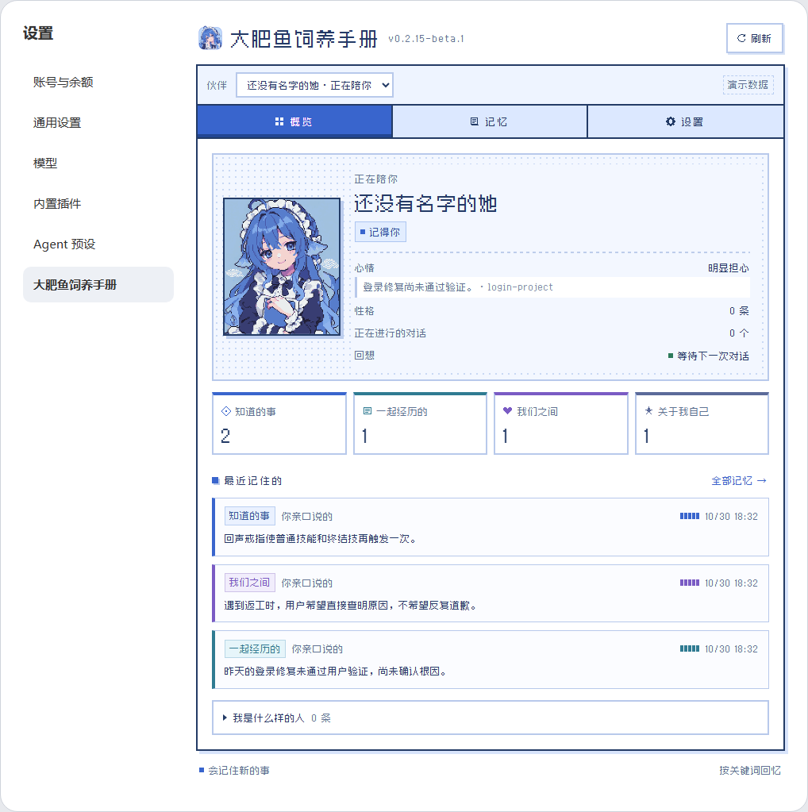

<div align="center">
  
</div>

# 大肥鱼饲养手册

**dsh-feed-the-seek** · DeepSeek Harness 个人记忆与陪伴插件

让 DeepSeek 在聊天和工作中记住你的习惯、共同经历和项目约定，并在新会话里继续使用。

[开始体验](#开始体验) · [使用与开发参考](docs/usage-guide.md) · [发布与收录](docs/publishing.md)

当前版本 **0.2.15-beta.1**，面向单人、本机使用。尚未发布到 npm；目前可以从源码构建、本地安装体验。

- **跨会话记忆**：同一伙伴在新对话中读取已有记忆，不必反复介绍自己和项目。
- **四类记忆**：认知、经历、共鸣与自我，分别保存知识与偏好、事件结果、相处方式和行为反馈。
- **自动整理**：从对话中提炼信息，判断新增、修正、失效或不处理，保留来源和变化记录。
- **情绪与成长**：近期事件影响表达，有效反馈参与稳定倾向的形成与修正。
- **本地即用**：无需额外向量服务；可选语义增强，找回措辞不同但含义相关的记忆。
- **设置内查阅**：在 DSH 中查看状态、记忆、整理任务与召回结果，也可以创建新的伙伴实例。

## 聊过的事，新会话还能接上

记忆不局限于个人资料。你提供的项目约定、某个游戏版本里的道具效果、上次任务为什么失败，都可以成为后续对话的参考。

| 记忆 | 可以记录什么 |
| --- | --- |
| 认知 | 「这个项目使用 pnpm」「这个道具只在指定版本免疫冰冻」「回答先给结论」 |
| 经历 | 一次部署失败的原因、共同完成的工作、已经解决的问题 |
| 共鸣 | 用户接受的玩笑尺度、交流边界、双方形成的协作方式 |
| 自我 | 「上次抢先执行造成返工」这样的行为观察，以及后续改进反馈 |

以上是内容示例，不是内置记忆。模型决定是否值得记录；已有内容发生变化时，可以更新旧记录，而非不断追加重复条目。不同项目、版本与适用条件需要分别保留。

## 记忆参与工作过程

每轮开始时，插件提供稳定偏好与相关记忆，让模型在理解问题、选择做法和组织回复时参考。它不只是给最终答案换一种语气。

**用户输入 → 召回相关记忆 → Agent 对话或执行任务 → 后台整理 → 后续回合使用更新结果。**

长任务中按步骤检查是否出现新的用户证据；回合结束后整理剩余内容。当前回合的自动注入快照保持稳定，后续消息再读取更新。模型也可以通过回忆工具主动查找具体内容。

## 近期状态与长期变化

近期事件可以影响伙伴的拟人状态和表达，状态随时间衰减，也能在问题解决后恢复。一次失败可以留下观察，但不会因为一两句话就形成固定人格。

自我观察需要积累反馈证据，才能形成或修正稳定倾向。情绪不应成为降低执行质量、故意不配合或向用户施压的理由。



*截图来自隔离演示环境，使用示例数据，不含真实对话。*

## 本地记忆与语义增强

默认把记忆保存在本机 SQLite，使用关键词、关联线索和个人资料检索。无需配置 Embedding 接口即可开始使用，自动整理仍会调用会话模型。

需要更好的近义表达检索时，可以启用**语义增强**：支持 OpenAI 兼容 Embeddings、Ollama `/api/embed`，以及火山方舟多模态接口的文本输入格式。服务负责生成向量，正文和向量索引保存在本机。

设置中可直接输入 API Key、测试连接和保存配置。测试连接只发送固定测试文字，不保存测试向量或结果。更换模型或维度后需要重新建立索引，正文记忆会保留；接口不可用时回退到本地检索。

## 查阅记忆，也可以重新养一个

设置页可以查看内容、来源、变更和整理状态，检查一次召回找到了什么。没有逐条手工编辑或删除记忆的入口；信息纠正通过后续交流参与整理。

可以创建新的伙伴实例，开始另一份记忆。同一伙伴的适用记忆会在关联会话间共享。

## 开始体验

需要 DeepSeek Harness，以及构建时可用的 **Node.js 22.21 或更新版本**。目前实测环境为 Windows 桌面版；其他平台尚未完成安装验证。

在项目目录执行：

```sh
npm ci
npm run build
npm run dev:dsh
```

开发命令会关联本机桌面版 DSH。首次关联或依赖变更后重启 DSH，再进入「设置 → 大肥鱼饲养手册」。退出开发链接并恢复安装版：

```sh
npm run dev:dsh:stop
```

Git 仓库分发需要同时提交 `dist/src` 中的运行文件和最新的 `public/client.js`。修改源码后先运行 `npm run build`，将生成文件一起提交；只上传源码会使安装触发构建授权错误。不能用忽略构建脚本来补齐缺失的入口。

需要本地安装包时执行 `npm pack`，会自动构建、检查分发内容并生成 `.tgz`。在 DSH 的「添加插件」中填入该文件的绝对路径，或按所用 profile 安装：

```sh
dsh plugin --profile web add ./dsh-feed-the-seek-0.2.15-beta.1.tgz
```

这是 CLI 的 `web` profile 示例；桌面应用拥有自己的 profile，桌面体验优先使用应用内安装或上述开发命令。

## QQ 等消息插件能一起用吗

如果消息插件使用同一个 DSH Agent 会话，记忆上下文可以参与模型回复；如果它绕过 DSH 自行请求模型，则不会生效。

**当前按一个用户设计，没有 QQ 群成员身份隔离。** 具体 QQ 插件尚未完成真实账号联调，不宜把含有个人记忆的伙伴直接开放给多人会话。消息来源标记也会影响自动学习，详见[接入边界](docs/usage-guide.md#qq-和其他消息插件)。

## 数据与费用

- 记忆默认保存于 `~/.dsh/yuwen/memory.sqlite`；自定义 `DSH_HOME` 时使用该目录。卸载插件不会自动删除记忆。
- 自动整理借用会话模型，会产生额外用量。开启语义增强后，还会调用所配置的 Embedding 服务，并向其发送相关文本。
- API Key 交由 DSH credentials 服务保存，前端不回传完整密钥。记忆数据库未额外加密，分享数据前需检查其中的个人信息。
- 提炼、检索和成长依赖模型判断，可能漏记或误判；当前仍是初始测试版。

## 开发与发布

```sh
npm test
npm run check:release
npm pack
```

分发检查核对资源完整性，并排除测试数据库、日志、凭据与个人绝对路径。详细机制与验证范围见[使用与开发参考](docs/usage-guide.md)，npm 发布和索引收录见[发布说明](docs/publishing.md)。

## 素材与许可

界面字体使用 [Zpix 最像素](https://github.com/SolidZORO/zpix-pixel-font)，其授权独立于代码，商业使用需遵守作者条款。角色为社区鲸鱼娘人设的同人生成素材，不是官方美术，见[素材说明](public/assets/ARTWORK.md)。

项目尚未选择开源许可证；公开发布前需要明确代码许可与素材使用范围。
