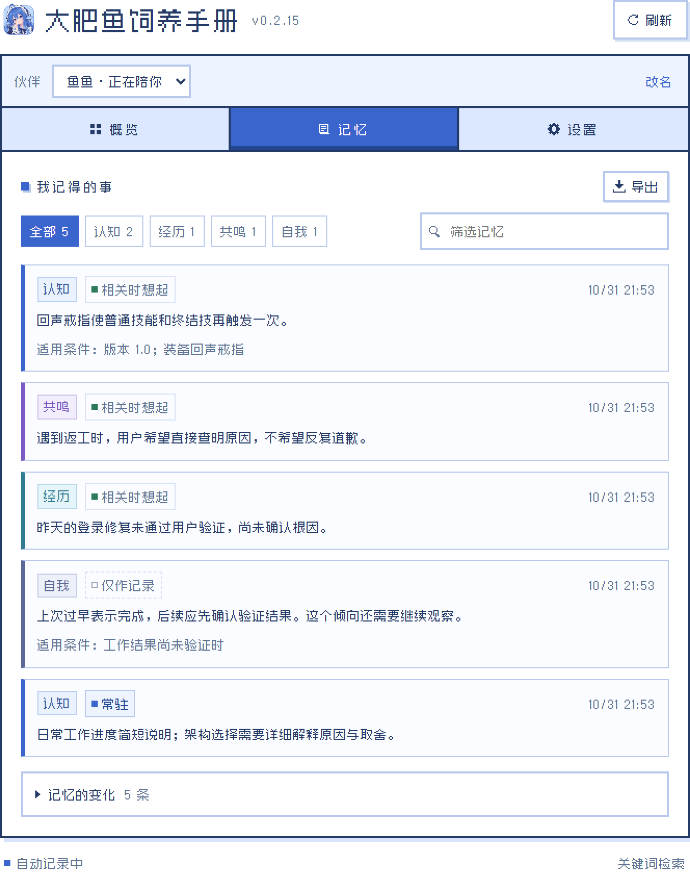
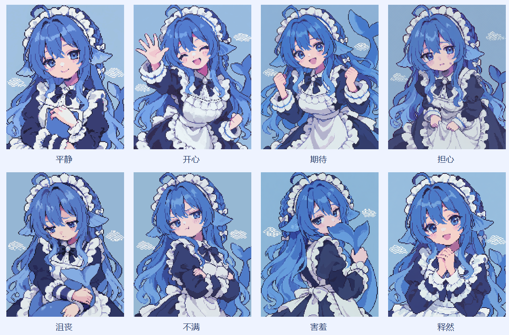
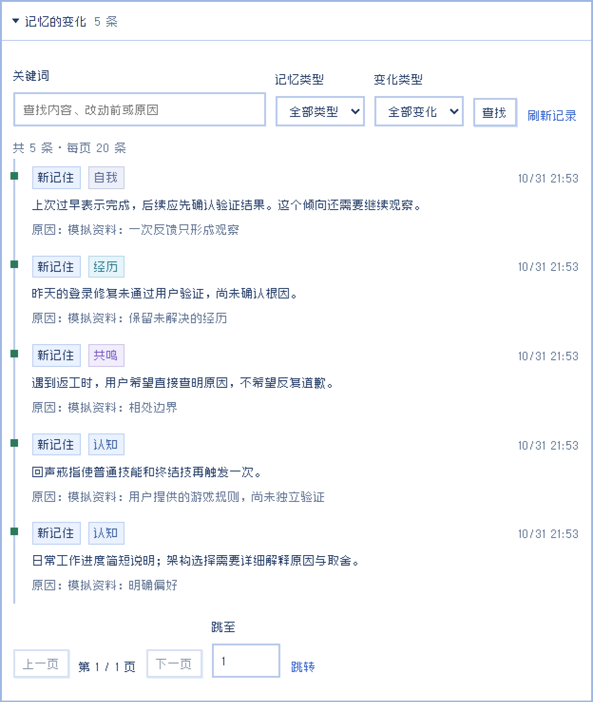
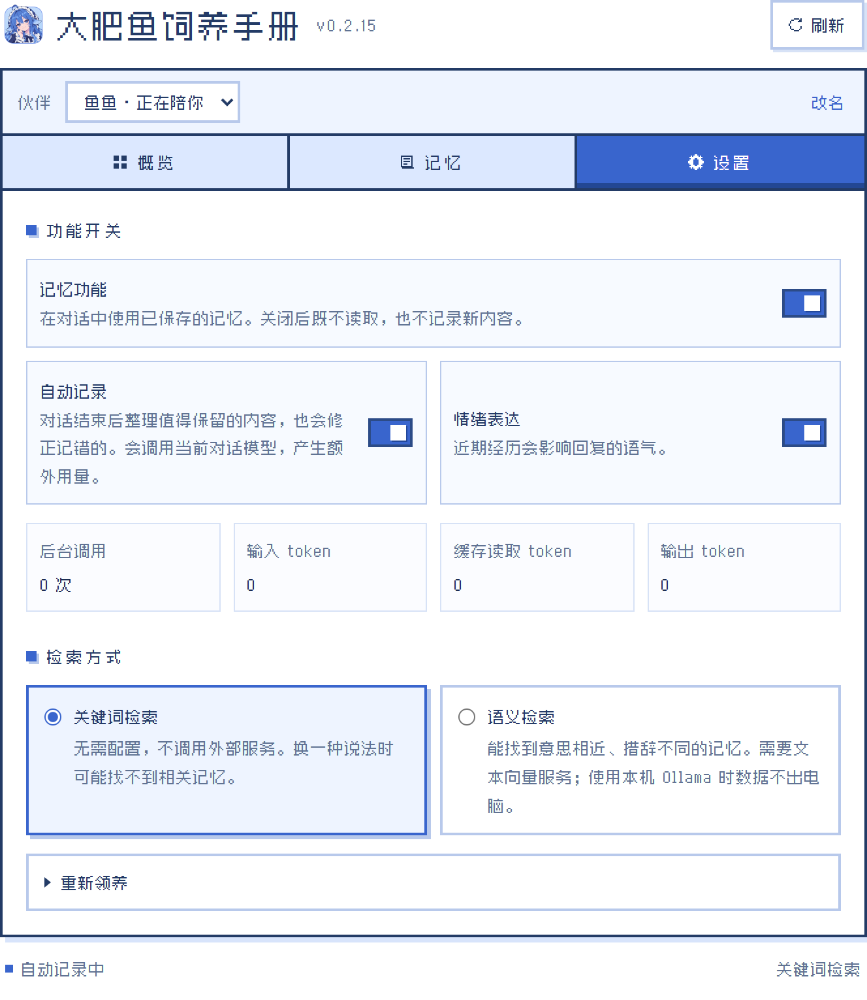

<div align="center">
  

# 大肥鱼饲养手册

**dsh-feed-the-seek** · DeepSeek Harness 记忆与陪伴插件

给 DeepSeek 养一条会记事的鱼。

[GitHub Release](https://github.com/Morgiana-V3/dsh-feed-the-seek/releases/tag/v0.2.16) · [使用与开发参考](docs/usage-guide.md) · [架构说明](docs/architecture.md)

</div>

大肥鱼会在你们的聊天和工作中慢慢认识你：你的习惯、你们一起经历过的事、你希望她怎么和你相处。换一个新对话，她还记得。

她也有自己的心情。事情顺利她会开心，修复没通过她会担心，被夸了会害羞——这些都会悄悄影响她说话的语气，过一阵子再慢慢平复。


## 换了对话，她还记得你

记忆属于伙伴本人，不属于某个项目或某次会话。你在写代码时告诉她「这个项目用 pnpm」，在闲聊时提到「我养的狗叫豆豆」，之后无论在哪个对话里，她都能接上。

她不会把每句话都存下来。普通的操作步骤、执行日志、客套寒暄会被略过，只有对「她这个人」有分量的事才会留下。同一件事有了新说法，她会改写旧记忆，而不是越记越乱。

## 四种记忆

她记住的东西分成四类，各管一块：

| | 记什么 | 例如 |
| --- | --- | --- |
| **认知** | 关于你和世界的知识 | 你是前端工程师；这个项目用 pnpm；某游戏 1.0 版里回声戒指能让技能再触发一次 |
| **经历** | 你们之间发生过的事 | 第一次见面、给她起名字、一起赶完的项目、吵过的架和后来的和好 |
| **共鸣** | 那些事留下的意义 | 你难过时她说的话让你好受了一点；你希望她出错时直接查原因，别反复道歉 |
| **自我** | 她怎么看待自己 | 「我叫大肥鱼」「我说话简洁，不用 emoji」「我容易过早说完成，要先确认结果」 |

版本、前提条件这类细节会和记忆一起保存，「只在 1.0 版成立」的规则不会被当成永远正确。



## 用得上的时候才想起来

每一轮对话，她只固定带着「自己」：名字、性格、你对她的长期要求和当前心情。其余的认知、经历和共鸣，只有话题相关时才会被想起，不会把所有记忆一股脑塞进上下文。需要的话，她也会主动翻找具体的旧事。

对话结束后，后台会把这一轮里值得留下的内容整理进记忆，下一轮就能用上。打招呼、算个 1+1 这种回合会直接跳过，不浪费调用。

## 八种心情，各有一张立绘

平静、开心、期待、担心、沮丧、不满、害羞、释然。每种心情都有独立的像素立绘（支持循环动图），强度分轻微、明显、强烈三档。

心情来自最近发生的事，会随时间衰减，问题解决后也会恢复，不会因为一两句话就来回乱跳。她的情绪只影响语气，不会影响干活的质量，更不会拿来闹脾气。



## 会慢慢成长

一次失误只会留下一条「观察」，不会立刻变成她的性格。同样的反馈积累多了，才会沉淀为稳定的倾向；你改变了要求，她也会跟着修正。

每一条记忆是怎么来的、什么时候改过、为什么改，都有完整的变化记录可以回溯。



## 本地优先，开箱即用

记忆保存在本机 SQLite 里，默认用关键词检索，不需要额外部署向量服务。

想让她听懂换了说法的同一件事，可以打开语义检索，支持 OpenAI 兼容 Embeddings、Ollama 和火山方舟。向量索引同样存在本地；用本机 Ollama 的话，数据完全不出电脑。接口不可用时会自动退回关键词检索。

后台整理用了多少次调用、多少 token，也都能直接看到。



## 也可以重新领养

想要一份全新的记忆，可以领养一个新伙伴。之后新开的对话由新伙伴陪伴，正在进行的对话还是原来那位。每个伙伴都可以起自己的名字。

## 安装

需要 DeepSeek Harness。目前在 Windows 桌面版上完成了验证，适合单人本地使用。

在 DSH 的「添加插件」中输入：

```text
dsh-feed-the-seek@0.2.16
```

或者从 [Release 页面](https://github.com/Morgiana-V3/dsh-feed-the-seek/releases/tag/v0.2.16)下载 `.tgz` 安装包，在「添加插件」中填写它的绝对路径。安装后完全退出并重新打开 DSH 即可。

从源码构建（需要 Node.js 22.21+）：

```sh
git clone https://github.com/Morgiana-V3/dsh-feed-the-seek.git
cd dsh-feed-the-seek
npm ci
npm pack
```

## 需要知道的事

- 记忆默认存放在 `~/.dsh/feed-the-seek/memory.sqlite`，卸载插件不会删除它。数据库没有额外加密，分享前请检查其中的个人信息。
- 自动整理会调用当前对话模型，开启语义检索还会调用 Embedding 服务，都会产生额外用量。
- 采集到的原文会先隐去常见的密钥格式；API Key 交给 DSH 的凭据服务保存。
- 目前按单个用户设计，没有区分多人身份。不建议把带有个人记忆的伙伴接入 QQ 群这类多人会话，详见[接入边界](docs/usage-guide.md#qq-和其他消息插件)。
- 记什么、怎么理解都依赖模型判断，可能漏记或记错，在后续聊天里纠正她就好。

## 开发

功能模块和依赖边界见[架构说明](docs/architecture.md)，代码约定见[代码写作约定](docs/coding-standards.md)，发布流程见[发布说明](docs/publishing.md)。

```sh
npm run dev:dsh      # 关联本机 DSH 并监听修改
npm test
npm run check:all
```

通过 Git 链接安装依赖仓库里的预构建文件，修改后记得运行 `npm run build` 并把 `dist/src` 与 `public/client.js` 一起提交。

## 素材与许可

界面字体使用 [Zpix 最像素](https://github.com/SolidZORO/zpix-pixel-font)，授权独立于代码。角色是社区鲸鱼娘人设的同人生成素材，不是官方美术，见[素材说明](public/assets/ARTWORK.md)。

项目代码与文档采用 [MIT 许可证](LICENSE)；角色图片、图标和字体不适用 MIT，分别遵循素材说明和字体上游条款。
